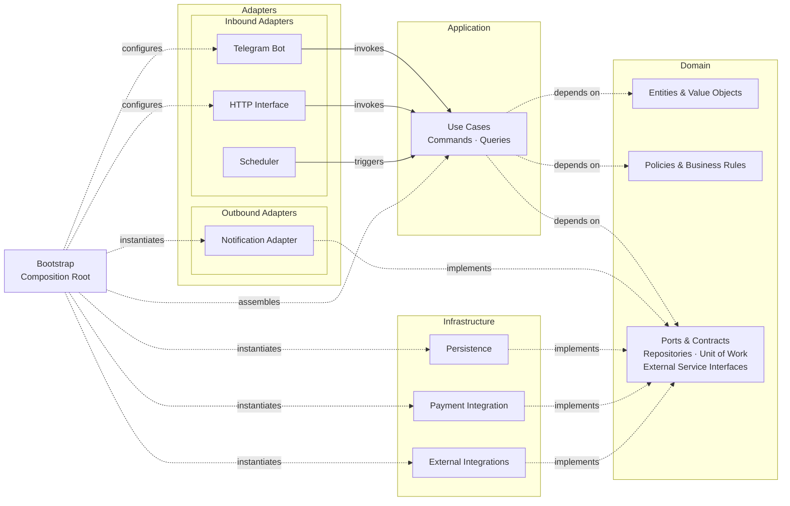

# Subscription Access Bot

A Telegram bot with a web backend that runs a subscription service end to end: onboarding and trials, tariffs, wallet
top-ups through a payment gateway, a referral program, per-device access control, and automated access provisioning.

It is deployed to production and used by real people. This repository is a **portfolio project**: its goal is to show
how I design and build a Rust service.

> Secrets, production configuration, user-facing copy and the client profile template are intentionally not part of the
> repository. The `*.example` files show their shape.

## What it does

- **Onboarding and trials:** registers users on `/start`, keeps their Telegram identity fresh, and grants a one-time
  trial.
- **Tariffs:** the price is a pure domain function of plan duration, device count and the user's frozen base price.
- **Wallet and payments:** top-ups go through an external payment gateway; all money movement is recorded in an
  append-only ledger.
- **Access provisioning:** provisions and updates user access through an external management API and serves personal
  subscription links generated from a template.
- **Device control:** enforces the per-subscription device limit and tells the user how to connect a new device.
- **Referral program:** a welcome bonus for the invited user and percentage cashback for the referrer on every tariff
  purchase.
- **Lifecycle automation:** an hourly scheduler revokes lapsed subscriptions and tracks expiry-warning delivery using
  persisted state.
- **Operations:** `ERROR` logs are forwarded to an admin chat, migrations run on startup, and the whole thing ships as a
  Docker-built binary.

## Architecture

The project follows **Clean Architecture**, **Domain-Driven Design** and **CQRS** principles with dependency inversion.
Inbound adapters handle external requests and invoke application use cases, while the domain layer defines the business
rules and abstractions. Infrastructure components and outbound adapters provide concrete implementations of these
abstractions. Dependencies are wired at startup through a dedicated composition root.



```text
src/
├── adapters/        # Telegram (handlers, callbacks, views), web (axum), scheduler
├── application/     # Use cases: commands (write side) and queries (read side)
├── domain/          # Entities, value objects, ports, business rules; no I/O
├── infrastructure/  # PostgreSQL (SQLx), payment gateway, external integration client, config
└── bootstrap.rs     # Composition root: builds and wires everything
```

The domain model covers the following business areas and supporting abstractions:

| Area         | Responsibility                                                                |
|--------------|-------------------------------------------------------------------------------|
| User         | Identity, trial eligibility, referral code, public identity for notifications |
| Subscription | Plans, device limits, lifecycle, renewal                                      |
| Billing      | Money, append-only ledger, pricing, payment gateway port                      |
| Access       | Access lifecycle, connection management, provisioning contracts               |
| Device       | Device registry, client identification, access decisions                      |
| Referral     | Referral links, bonus and cashback policies, invariants                       |
| Notification | Outbound notification port                                                    |
| Unit of Work | Transactional repository access                                               |

## Engineering decisions worth a look

**1. A domain that protects itself.** Entities keep their fields private and change state only through methods that
enforce invariants. Value objects (`Money`, `TelegramId`, `ReferralCode`, `SubscriptionDevices`, ...) validate on
construction, so a negative balance or a malformed code cannot exist past the boundary. Persisted rows become entities
again through dedicated reconstitution constructors (`restore_from_db`), so the rules are not bypassed on load. See
`src/domain/`.

**2. CQRS without ceremony.** Every use case is its own struct with a single `execute`. Commands mutate state, queries
only read (a price quote, for example, never touches the database state). One `UseCases` container is built once in the
composition root. See `src/application/usecases/`.

**3. A Unit of Work that keeps the ports clean.** Repositories are trait objects that behave the same on the connection
pool and inside a transaction. The transaction sits behind `Arc<tokio::sync::Mutex<Option<Transaction>>>`, so no
lifetimes leak into the domain traits; the price is that a context must not be used concurrently, which the use cases
respect by querying sequentially. The `in_transaction!` macro guarantees a commit on success and a rollback on every
error path. See `src/macros.rs` and `src/infrastructure/database/uow.rs`.

**4. A ledger instead of a balance column.** Money moves through an append-only `transactions` table: amounts are always
positive (`CHECK (amount > 0)`), the direction comes from the transaction kind, and the balance is computed with `SUM`
in the query, so there is no second source of truth to drift. Unique constraints on `order_id` and the provider
transaction ID prevent duplicate records and support idempotent processing. A purchase debits the wallet, creates or
renews the subscription and credits the referrer's cashback in one atomic transaction. See `src/domain/billing/` and
`src/application/usecases/commands/purchase_tariff.rs`.

**5. A webhook is a hint, not a fact.** The payment gateway does not sign its callbacks, so the handler treats an
incoming webhook only as a trigger: the source address is checked against an allowlist, then the transaction status is
fetched from the gateway's API, and only that response changes the ledger. See `src/adapters/web/`.

**6. No network calls inside database transactions.** External provisioning deliberately runs outside any DB
transaction: holding a connection while waiting for an external API starves the pool and cannot be rolled back anyway.
Instead, provisioning is idempotent and reconciles partial results of the remote management API. See
`src/application/usecases/commands/` and `src/infrastructure/`.

**7. Let the database settle races.** Uniqueness and invariants live in constraints (`UNIQUE (referred_id)`,
`CHECK (referrer_id <> referred_id)`, one active subscription per user), and unique-violation errors are translated into
domain outcomes instead of check-then-insert logic in the application. Expiry warnings use a persisted `is_warning_sent`
flag rather than time windows, making the process resilient to restarts and avoiding routine duplicate notifications.

**8. Exhaustive access decisions.** Whether an access request is granted, redirected to an onboarding
step, or refused is decided in one use case that returns an exhaustive `DeviceAccess` enum. The web adapter only maps
each variant to a response, so the compiler flags any unhandled case. Request classification and the allowlist of
supported client types live in the domain. See `src/domain/device/` and
`src/application/usecases/commands/register_device.rs`.

**9. Built to be operated.** A custom `tracing` layer forwards `ERROR` events to an admin Telegram chat (deduplicated by
call site), so failures reach me without watching logs. Secrets are redacted in manual `Debug` implementations.
Migrations are embedded into the binary and applied on startup. The Docker build is multi-stage (cargo-chef) and
compiles with SQL checks done offline from the committed `.sqlx` data. See `src/adapters/telegram/alerts.rs` and
`Dockerfile`.

## Testing and code quality

- 240 automated tests. Domain and application layers are covered by fast unit tests that need no database, using
  handwritten in-memory fakes instead of a mocking framework.
- Repository code is verified with `#[sqlx::test]` integration tests (device repository so far). Extending this to the
  remaining repositories, plus contract tests for the external integration clients, is the main known gap.
- `clippy::pedantic` and `clippy::nursery` are enabled project-wide; lint exceptions use
  `#[expect(..., reason = "...")]`.
- SQL queries are validated using SQLx macros and schema-derived metadata.
- A test verifies that every placeholder in the localization file matches what the code substitutes.

## Tech stack

Rust (edition 2024, stable) · Tokio · Teloxide · Axum · SQLx · PostgreSQL · Reqwest · Tracing · Serde, TOML · Thiserror,
Anyhow, Strum · Docker

## Development notes

- The Rust toolchain is pinned in `rust-toolchain.toml`. SQLx query metadata is committed, allowing query validation
  without a live database (`SQLX_OFFLINE=true`).
- PostgreSQL is required for integration tests (`#[sqlx::test]`). Database migrations are applied automatically on
  startup.
- Running the service requires valid Telegram credentials and configuration for external integrations. Production
  configuration and client-specific templates are intentionally excluded.

## License

Licensed under the GNU Affero General Public License v3.0 (AGPL-3.0). See [`LICENSE`](LICENSE).

## Contact

If you are hiring, or reviewing this code and want to talk about it, message me on
Telegram: [@SevereILya](https://t.me/SevereILya)